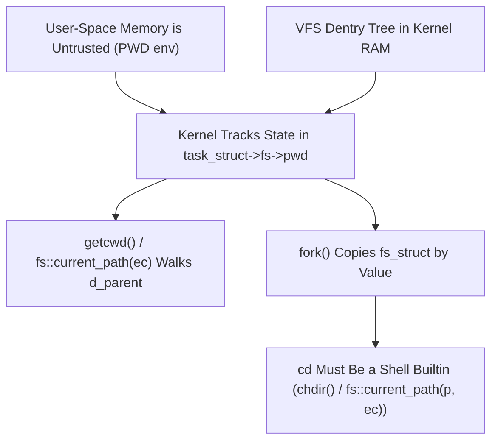

# Process Working Directory, `task_struct`, and `pwd` / `cd`

> **Mastery Status**: 🌿 Solid  
> **Date**: 2026-10-25  
> **Prerequisites**: [Resolving Executables via PATH](path-searching-executables.md)  

---

## 1. Unconditional Truths (The Bedrock)

- **Kernel Authority Over Process State**: The kernel never trusts user-space memory (such as the `PWD` environment variable) for filesystem resolution or permission checks. The authoritative working directory lives strictly in protected kernel RAM.
- **`task_struct` Indirection**: In Linux, every process descriptor (`struct task_struct`) contains a pointer `struct fs_struct *fs`. Inside `fs_struct` sits `struct path pwd` (alongside `struct path root`).
- **Live Directory Node (`dentry`) vs. Static String**: `pwd` is stored as a pair of kernel pointers (`vfsmount *mnt`, `dentry *dentry`) pointing directly to the live directory node in the VFS RAM tree, where each `dentry` links to its parent via `d_parent`.
- **Process Isolation on `fork()`**: Calling `fork()` duplicates the parent's `fs_struct` into a separate `fs_struct` allocation for the child (`child_fs = parent_fs`). Both initially hold the same `pwd.dentry` pointer value, but reassigning the child's pointer (`chdir`) does not alter the parent's struct.

---

## 2. The Dependency Map



---

## 3. Motivated Discovery (The "Why")

- **Why Not Point into User-Space `PWD`?**: A process can overwrite `PWD` with invalid addresses (causing kernel faults) or unauthorized paths like `"/root"` without traversing permissions (`X_OK`).
- **Why Point to a `dentry` Instead of Storing a Path String?**:
  1. **Zero Stale Cache on Rename**: If `/home/adam/old_dir` is renamed to `/home/adam/new_dir`, only that single `dentry`'s name changes in $O(1)$ time. Every process inside `old_dir/sub` automatically resolves to the new path when walking `d_parent`.
  2. **$O(1)$ Relative File Lookups**: When calling `open("main.cc")`, the kernel never walks up to `/`. It starts directly at `pwd.dentry` and looks down one step. It only walks up `d_parent` when a user explicitly asks for the path string via `getcwd()`.
- **Why `pwd` Can Be External (`/bin/pwd`) While `cd` Must Be a Builtin**:
  ```cpp
  fs_struct parent_fs{.pwd_dentry = &home_dir};
  fs_struct child_fs = parent_fs;      // fork() copies the pointer value
  child_fs.pwd_dentry = &tmp_dir;      // chdir() only reassigns child_fs's pointer!
  ```
  Reading `child_fs.pwd_dentry` in a forked child sees `&home_dir`, so `/bin/pwd` works. Reassigning `child_fs.pwd_dentry` in a forked child leaves `parent_fs.pwd_dentry` unchanged when the child exits, so `cd` cannot be outsourced to a child process.

---

## 4. Misconceptions Dislodged

| Misconception | Why It Was Tempting | Correction | Discriminator |
| :--- | :--- | :--- | :--- |
| **"The kernel reads a pointer to the user-space `PWD` environment variable"** | Shells always keep `PWD` updated, making it look like the single source of truth. | User-space memory can be corrupted or forged without permission checks; the kernel keeps `task_struct->fs->pwd` in kernel RAM. | `PWD` is a user-space convenience mirror (`pwd -L`); `getcwd()` queries kernel truth (`pwd -P`). |
| **"Walking up `d_parent` makes every relative file access slow in deep directories"** | If `pwd` only points to the leaf node, reconstructing the path requires walking to `/`. | Relative lookups (`open("a.txt")`) start directly at `pwd.dentry` and go *down* in $O(1)$ time; walking *up* only happens on `getcwd()`. | Relative open = $O(1)$ downward lookup; `getcwd()` = upward RAM walk (~50 ns). |
| **"Modifying `pwd.dentry` in a child affects the parent since both held the same pointer"** | Confusion between mutating a shared pointee (`*ptr`) vs. reassigning a copied pointer (`ptr = &other`). | `chdir()` reassigns the pointer field inside the process's own `fs_struct`, not the `dentry` object itself. | `child_fs.pwd_dentry = &tmp` vs `*child_fs.pwd_dentry = ...`. |

---

## 5. What Clicked (Effective Analogies & Examples)

- **Node**: Process isolation of working directory across `fork()`.
- **What worked**: Writing the 6-line C++ struct-copy model (`fs_struct child_fs = parent_fs; child_fs.pwd_dentry = &tmp_dir;`).
- **Why it worked**: Immediately distinguished copying a struct containing a pointer from mutating the pointed-to directory node.

---

## 6. Active Recall Flashcards (Self-Quiz)

<details>
<summary><b>Q1: How does the Linux kernel store a process's current working directory inside <code>task_struct</code>?</b></summary>

**Answer**: `task_struct` holds a pointer `struct fs_struct *fs`, which contains `struct path pwd` — a pair of pointers (`vfsmount *mnt` and `dentry *dentry`) pointing to the live directory node in the kernel's VFS `dentry` cache.
</details>

<details>
<summary><b>Q2: What is the difference between <code>pwd -P</code> and <code>pwd -L</code> in POSIX shells?</b></summary>

**Answer**: `pwd -P` (Physical) invokes `getcwd()` to ask the kernel to walk `pwd.dentry -> d_parent` up to `/`, resolving all symlinks. `pwd -L` (Logical) reads the user-space `PWD` environment variable, preserving symlink names used during `cd`.
</details>

<details>
<summary><b>Q3: Why can `/bin/pwd` work as an external binary spawned via `fork()`, whereas `cd` must be a shell builtin?</b></summary>

**Answer**: `fork()` copies the parent's `fs_struct` into a new `fs_struct` for the child. Both structs initially hold the same `pwd.dentry` pointer, so a child running `/bin/pwd` reads the parent's directory accurately. However, `chdir()` only reassigns the `pwd.dentry` pointer inside the calling process's own `fs_struct`—if run in a child, the parent shell's `fs_struct` remains unchanged.
</details>

---

## 7. Interleaved Review Challenges

<details>
<summary><b>Challenge 1: Why does storing a live <code>dentry*</code> in <code>fs_struct</code> avoid the same bug as querying <code>std::getenv("PATH")</code> dynamically?</b></summary>

**Which principle applies?**: Avoiding stale cached strings when underlying state mutates.
**Solution**: If `task_struct` stored a static path string `"/home/adam/old/sub"`, renaming `old` to `new` would make the stored string stale—just like caching `PATH` at shell startup breaks when `PATH` is modified. Pointing to the live `dentry` node ensures `getcwd()` always constructs the fresh, current path on demand.
</details>

---

*See also: [Resolving Executables via PATH](path-searching-executables.md) — both lessons share the core systems principle of avoiding stale string caches in favor of fast (~50 ns) on-demand resolution, and using non-throwing `std::filesystem` overloads with `std::error_code ec`. Visual diagrams: [task-struct-pwd.md](viz/task-struct-pwd.md).*
