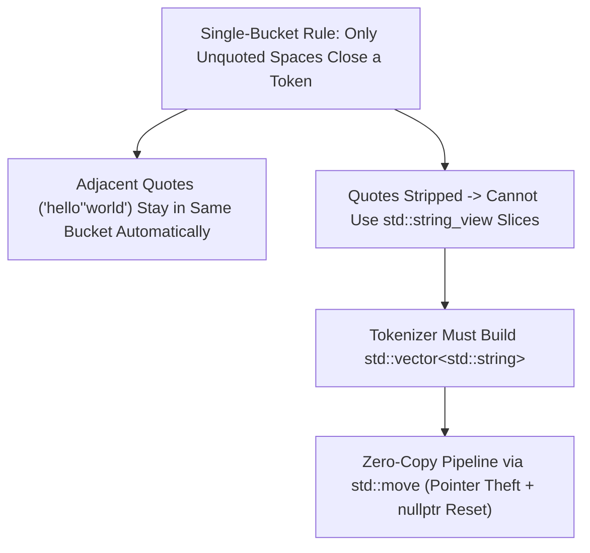

# Shell Quoting State Machine & C++ Move Semantics

> **Mastery Status**: 🌿 Solid  
> **Date**: 2026-10-25  
> **Prerequisites**: [Process Working Directory, `task_struct`, and `pwd` / `cd`](process-working-directory-task-struct.md)  

---

## 1. Unconditional Truths (The Bedrock)

- **The Single-Bucket Token Rule**: As a shell scans left-to-right, characters drop into a single active bucket (`current_token`). **Only an unquoted space (or end-of-input) finishes the bucket.**
- **Quotes Are Shield Toggles, Not Boundaries**: Quote characters (`'` and `"`) never start or finish a token bucket. They are swallowed and toggle quote mode, which temporarily disables space-splitting while filling the **exact same bucket**.
- **Single vs. Double Quote Shielding**:
  - **Single-Quote Mode (`'...'`)**: Total shield. Every character (including spaces `' '` and double quotes `"`) is literal until the closing `'`.
  - **Double-Quote Mode (`"..."`)**: Spaces `' '` and single quotes `'` are literal until the closing `"`.
- **C++ Move Semantics = Pointer Theft**: `std::string` and `std::vector` are small stack structs holding a heap pointer (`char *data`), `size`, and `capacity`. Moving (`b = std::move(a)`) copies the pointer (`b.data = a.data`) and nulls the source (`a.data = nullptr`) in $O(1)$ time so `a`'s destructor does not free `b`'s stolen buffer.

---

## 2. The Dependency Map

---

## 3. Motivated Discovery (The "Why")

- **Why "Adjacent String Concatenation" Is Not a Separate Rule**: Tutorials often present `"hello""world" -> helloworld` as a special concatenation rule. In reality, when the second `"` closes and the third `"` opens, no unquoted space ever occurred—so `current_token` never closed. This allows mixing unquoted flags with quoted values (`--msg="fix bug"`) and mixing `'single'` and `"double"` quotes in one argument.
- **Why You Cannot Move from a `const` Reference**: Moving requires setting `source.data = nullptr` so `source`'s destructor does not `delete[]` the buffer that the destination just stole. Because `const` forbids modifying `source`, `ParseSimpleCommand(std::vector<std::string> tokens)` must take `tokens` by non-`const` value to move its strings into `SimpleCommand`.

---

## 4. Misconceptions Dislodged

| Misconception | Why It Was Tempting | Correction | Discriminator |
| :--- | :--- | :--- | :--- |
| **"Quotes define separate tokens that later get concatenated"** | In C++, `"hello"` is a standalone string literal token. | In shells, everything is already a string; quotes just toggle space-splitting OFF/ON inside the current token. | Trace `echo "hello"world` — token only finishes at the unquoted space after `d`. |
| **"`if (c == ' ' && !current_token.empty()) ... else current_token += c` skips extra spaces"** | Looks like it only triggers on non-empty tokens. | When a second consecutive space arrives, `current_token` is empty, so the compound `if` is `false` and execution falls into `else`, appending `' '`! | Guard `else if (c != ' ')` or nest `if (!current_token.empty())` inside `else if (c == ' ')`. |

---

## 5. What Clicked (Effective Analogies & Examples)

- **Node**: Collapsing quote grouping and adjacent string concatenation.
- **What worked**: The **Single-Bucket Trace** ([shell-quoting-state-machine.md](viz/shell-quoting-state-machine.md)) showing `current_token` staying open across `"hello""world"`.
- **Why it worked**: Replaced two seemingly arbitrary, disconnected rules with one unified state-machine invariant.
- **Node**: C++ `std::move` mechanics.
- **What worked**: Explaining `std::string` as a stack struct holding `char *data` ([cpp-move-semantics.md](viz/cpp-move-semantics.md)) and asking what happens when `a`'s destructor runs if `a.data` isn't nulled out.

---

## 6. Active Recall Flashcards (Self-Quiz)

<b>Q1: Why does <code>echo "hello""world"</code> produce a single argument <code>helloworld</code> without any special concatenation code?</b>

**Answer**: Because only an unquoted space closes the current token bucket. Quote characters are swallowed and only toggle `in_quotes` ON/OFF—since no unquoted space appears between `"hello"` and `"world"`, both are appended into the same `current_token` bucket.

<b>Q2: Why couldn't <code>SplitWithQuoting</code> return <code>std::vector&lt;std::string_view&gt;</code> like <code>Split</code> did?</b>

**Answer**: A `std::string_view` is a contiguous window into the raw input string. Because quoting strips quote characters from the middle of tokens (e.g. `"hello""world"` $\rightarrow$ `helloworld`), the token characters are not contiguous in the original buffer and require constructing a new `std::string`.

<b>Q3: What two pointer operations happen during <code>b = std::move(a)</code> on a <code>std::string</code>, and why can't <code>a</code> be <code>const</code>?</b>

**Answer**: (1) `b.data = a.data` (steal the heap buffer pointer), and (2) `a.data = nullptr` (prevent `a`'s destructor from freeing the stolen buffer when `a` goes out of scope). Because step 2 mutates `a`, `a` cannot be `const`.

