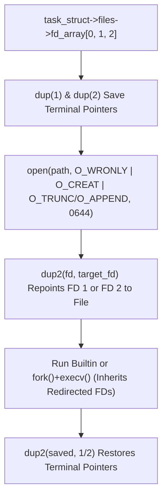

# Kernel TTY Line Discipline & File Descriptor Redirection (`dup` / `dup2`)

> **Mastery Status**: 🌿 Solid  
> **Date**: 2026-10-26  
> **Prerequisites**: [Process Working Directory, `task_struct`, and `pwd` / `cd`](process-working-directory-task-struct.md), [Shell Quoting State Machine & C++ Move Semantics](shell-quoting-and-move-semantics.md)  

---

## 1. Unconditional Truths (The Bedrock)

- **Zero Shell Code in the Kernel**: `/bin/bash`, `/bin/zsh`, and custom C++ shells are equal user-space programs that invoke the same POSIX system calls (`read`, `write`, `fork`, `execve`, `waitpid`, `chdir`, `dup2`).
- **The Kernel TTY Line Discipline (`drivers/tty/n_tty.c`)**: While a parent shell sleeps in `waitpid()` and a foreground program sleeps in `read(0)` (`std::getline`), the **Kernel TTY Driver** echoes typed characters to the screen (`ECHO`), handles Backspace in a kernel line buffer (`ICANON`), and only wakes up `read(0)` when `Enter` (`'\n'`) is pressed.
- **Process File Descriptor Table (`task_struct->files->fd_array`)**: Every process has an array of open file pointers in kernel memory:
  - Index `0` (`STDIN_FILENO`): Standard Input
  - Index `1` (`STDOUT_FILENO`): Standard Output (`std::cout`, `/bin/ls` normal output)
  - Index `2` (`STDERR_FILENO`): Standard Error (`std::cerr`, `/bin/ls` error output)
- **`dup2(fd, target_fd)` Redirection**: Overwrites `fd_array[target_fd]` to point to the same kernel file object as `fd`. Because both `fork()` and `execv()` preserve `fd_array`, redirecting Index `1` or `2` inside `Execute()` redirects both builtins and external programs without modifying any `std::cout` calls.

---

## 2. The Dependency Map

---

## 3. Motivated Discovery (The "Why")

- **Why Replacing `std::cout` in C++ Code Is Not Enough**: When `ExecuteExternal` runs `fork()` + `execv("/bin/ls", ...)`, the child's C++ memory is wiped and replaced by `/bin/ls`. `/bin/ls` only knows about Kernel FD `1` and FD `2`. By redirecting FD `1` and FD `2` at the kernel level via `dup2`, both `std::cout` and `/bin/ls` are redirected uniformly.
- **Why the Parent Shell Must Save and Restore FD `1` and FD `2`**: Builtin commands (`echo hi > out.txt`) run inside the parent shell process without `fork()`. If the parent shell repoints FD `1` to `out.txt` without restoring it afterward via `dup2(saved_stdout, STDOUT_FILENO)`, all subsequent `$ ` prompts and outputs would continue writing into `out.txt`.

---

## 4. Misconceptions Dislodged

| Misconception | Why It Was Tempting | Correction | Discriminator |
| :--- | :--- | :--- | :--- |
| **"`bash` reads the keyboard and forwards input to my program"** | Characters echo on screen while `std::getline` is still waiting for Enter. | `bash` is asleep inside `waitpid()`; the **Kernel TTY Driver** echoes characters and buffers the line until Enter. | Check `ExecuteExternal`: our own shell sleeps in `waitpid()`, yet child programs still receive keyboard input! |
| **"`echo hi > a.txt > b.txt` writes output into multiple files"** | Multiple `>` operators appear on the command line. | FD `1` is a single pointer; each `dup2(fd, 1)` overwrites FD `1`, so `a.txt` is created empty and only the final target (`b.txt`) receives output. | Single pointer `fd_array[1]` vs. tee buffer. |

---

## 5. Active Recall Flashcards (Self-Quiz)

<b>Q1: While your program is blocked inside <code>std::getline(std::cin, line)</code> and you type letters and press Backspace, what component is echoing those letters to the screen?</b>

**Answer**: The **Kernel TTY Driver's Line Discipline** (in Canonical + Echo mode). Both the parent shell (in `waitpid`) and your program (in `read(0)`) are asleep until you press Enter (`'\n'`).

<b>Q2: Why can you call <code>close(fd)</code> immediately after <code>dup2(fd, r.target_fd)</code> before the command even runs?</b>

**Answer**: Because `dup2(fd, r.target_fd)` copies the kernel file pointer into `fd_array[r.target_fd]` (increasing the kernel file's reference count). Once `r.target_fd` (`1` or `2`) points to the file, the temporary slot `fd` (e.g., FD `5`) is a duplicate pointer that is no longer needed.

---

*Visual diagrams: [kernel-tty-shell-architecture.md](viz/kernel-tty-shell-architecture.md) and [file-descriptor-redirection.md](viz/file-descriptor-redirection.md).*
