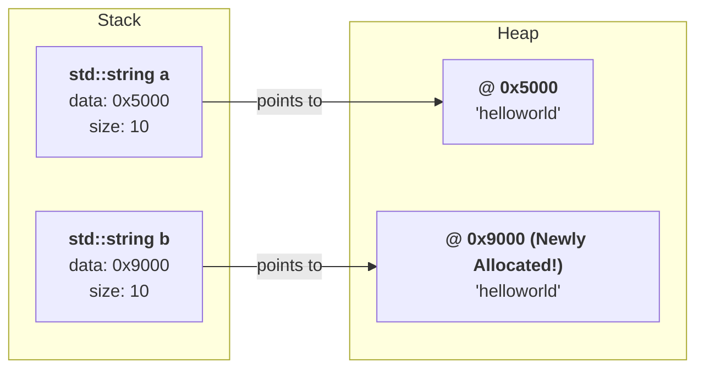
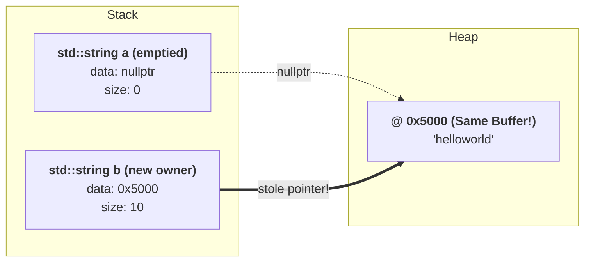

# C++ Move Semantics: Pointer Theft vs. Deep Copy

At the hardware level, both `std::string` and `std::vector` are small stack structs containing a **pointer (`data`)** to a heap buffer, plus `size` and `capacity`.

---

## 1. Deep Copy (`std::string b = a;`)

Allocates a **new** heap buffer and copies every byte ($O(N)$):



---

## 2. Move (`std::string b = std::move(a);`)

Allocates **nothing** ($O(1)$). `b` steals `a`'s heap pointer, and resets `a.data = nullptr` so `a`'s destructor won't free the buffer:



---

## In 5 Lines of C++ (How Move Constructor Actually Works)

```cpp
struct SimpleString {
  char *data;
  size_t size;

  // Move operation ("steal the pointer"):
  void MoveFrom(SimpleString &source) {
    this->data = source.data;   // 1. Point to source's existing heap array
    this->size = source.size;
    source.data = nullptr;      // 2. Null out source so its destructor does nothing!
    source.size = 0;
  }
};
```
