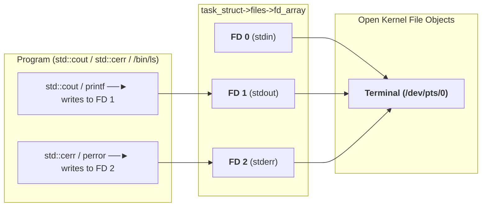
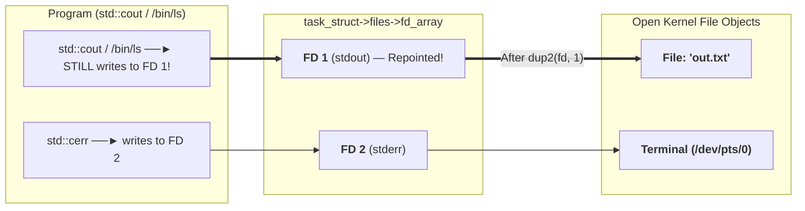

# Kernel File Descriptor Table (`task_struct->files`) & `dup2()` Redirection

Just like `task_struct->fs` holds your process's `pwd` pointer, `task_struct->files` holds an array of pointers called the **File Descriptor Table (`fd_array`)**.

> **Unconditional Truth**:
> 1. Every program (`std::cout`, `std::cerr`, `/bin/ls`, `cat`) blindly writes normal output to **FD `1` (`STDOUT_FILENO`)** and error output to **FD `2` (`STDERR_FILENO`)**.
> 2. Both `fork()` and `execv()` **keep the open File Descriptor Table intact**!
> 3. The `dup2(old_fd, new_fd)` system call copies the pointer at `fd_array[old_fd]` into `fd_array[new_fd]`.

---

## 1. Normal State (Before Redirection)

Both FD `1` (`stdout`) and FD `2` (`stderr`) point to the Terminal (`TTY`):

---

## 2. Redirected State (`ls > out.txt` via `open()` + `dup2(fd, 1)`)

1. `int fd = open("out.txt", O_WRONLY | O_CREAT | O_TRUNC, 0644);` creates **FD `3`** pointing to `out.txt`.
2. `dup2(fd, 1);` overwrites **FD `1`**'s pointer so **FD `1` now points to `out.txt`**!
3. `close(fd);` cleans up temporary FD `3`.

Notice that **neither `std::cout` nor `/bin/ls` changes at all**—they still write to FD `1`, and the kernel silently routes FD `1` into `out.txt`!
