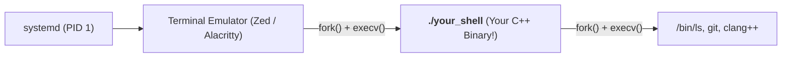
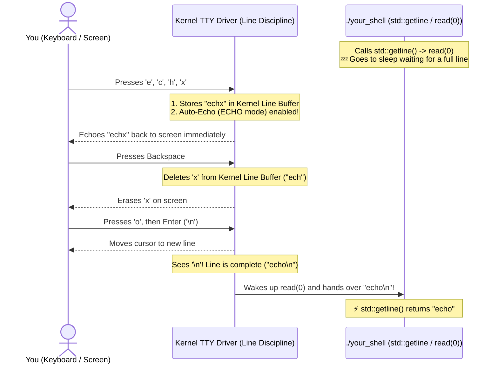

# The Kernel, the Terminal (TTY), and User-Space Shells

> **Unconditional Truth**: The Linux kernel contains **zero** shell code. `bash`, `zsh`, `/bin/sh`, and your C++ shell are all ordinary user-space programs that talk to the kernel using the exact same system calls (`read`, `write`, `fork`, `execve`, `waitpid`, `chdir`, `getcwd`).

---

## 1. Who Actually Reads the Keyboard? (When You Run `./your_shell` Inside `bash`)

A common misconception is that `bash` sits between the terminal and your program, reading your keystrokes and forwarding them to `./your_shell`.

In reality, the moment `bash` spawns `./your_shell`, **`bash` goes completely to sleep inside `waitpid()`** (just like your own [`ExecuteExternal`](../../src/executor.cc#L181) does!). Your C++ shell reads directly from the **Kernel TTY (Terminal) Driver** via file descriptor `0` (`stdin`):

```mermaid
graph TD
    subgraph User ["User & Terminal Emulator (Alacritty / GNOME Terminal / Zed)"]
        KB["Keyboard Input & Screen Output"]
    end

    subgraph Kernel ["Linux Kernel Space"]
        TTY["<b>Kernel TTY / PTY Driver</b> (/dev/pts/0)<br/>Line discipline, Ctrl+C signal, input buffer"]
        SYSCALL["<b>System Call Interface</b><br/>read(0), write(1), fork(), execve(), waitpid(), chdir()"]
    end

    subgraph UserSpace ["User Space Processes (All Equal Peers!)"]
        BASH["<b>/bin/bash</b> (Parent Process)<br/>💤 <b>ASLEEP inside waitpid()!</b><br/>Does NOT touch keyboard input"]
        YOURS["<b>./your_shell</b> (Foreground Process)<br/>⚡ <b>AWAKE!</b> Calls std::getline ──► read(0, ...)"]
    end

    KB <==>|Bytes| TTY
    TTY <==>|FD 0 (stdin) & FD 1 (stdout)| SYSCALL
    SYSCALL -.->|"Blocked waiting for child to exit"| BASH
    SYSCALL <==>|"Direct syscall: read(0) / write(1)"| YOURS
```

---

## 2. How Your C++ Shell Can Be the *Only* Shell (Zero `bash` Involved)

When you log into Linux or open a terminal window, the terminal emulator looks up your preferred shell in `/etc/passwd` (e.g., `/bin/bash` or `/bin/zsh`) and `execve()`s it directly.

If you change your terminal settings (or `/etc/passwd`) to point to `/path/to/your_shell`, the process tree looks like this—with **no `bash` or `zsh` running at all**:



---

## 3. Who Echoes Letters & Handles Backspace Before You Press Enter? (The Kernel TTY Line Discipline)

While you are typing `e`, `c`, `h`, `o`, **both** `bash` (in `waitpid`) and `./your_shell` (in `read(0)`) are **asleep**!

The component that echoes letters to your screen, handles Backspace, and waits for `Enter` is the **Kernel TTY Line Discipline** (`drivers/tty/n_tty.c`):



