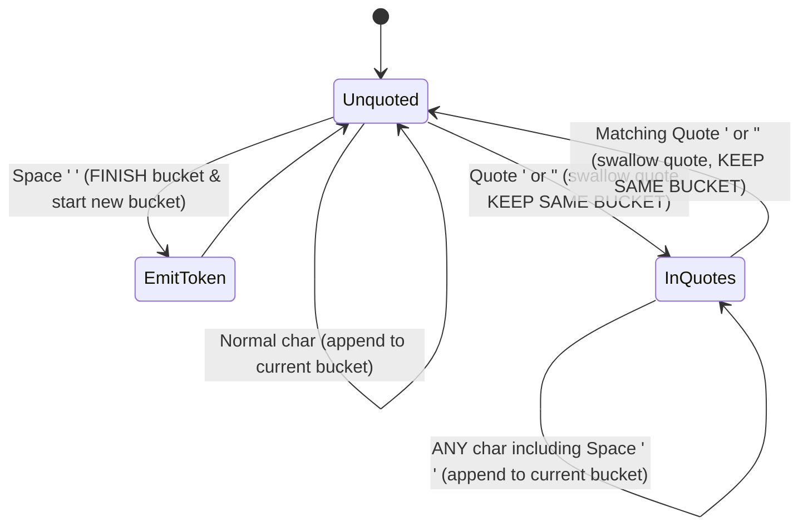

# The Single-Bucket Rule: Why Quotes Concatenate Automatically

There are **not** two separate rules ("quotes group spaces" + "adjacent strings concatenate"). There is only **one** rule:

> **Unconditional Truth**: Only an **unquoted space** finishes the current token bucket. Quote characters (`'` and `"`) **never** start or finish a bucket—they only toggle a switch (`in_quotes`) that tells the scanner whether spaces are currently allowed to finish the bucket.

---

## State Machine Diagram

---

## Character-by-Character Trace of `"hello""world"`

Notice that at no point are two strings created and joined. A single bucket (`current_token`) simply stays open the entire time because **no unquoted space ever appeared**:

| Step | Input Char | `in_quotes` State | Action | `current_token` Bucket |
| :---: | :---: | :---: | :--- | :--- |
| 1 | `"` | `false` $\rightarrow$ `true` | Swallow `"`, flip switch ON | `""` |
| 2 | `h..o` | `true` | Append chars to bucket | `"hello"` |
| 3 | `"` | `true` $\rightarrow$ `false` | Swallow `"`, flip switch OFF (**bucket stays open!**) | `"hello"` |
| 4 | `"` | `false` $\rightarrow$ `true` | Swallow `"`, flip switch ON (**same bucket!**) | `"hello"` |
| 5 | `w..d` | `true` | Append chars to bucket | `"helloworld"` |
| 6 | `"` | `true` $\rightarrow$ `false` | Swallow `"`, flip switch OFF | `"helloworld"` |
| 7 | `EOF` | `false` | End of input: emit bucket | **Emits `["helloworld"]`** |
