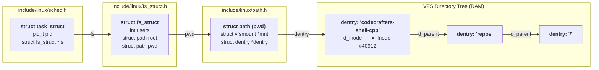
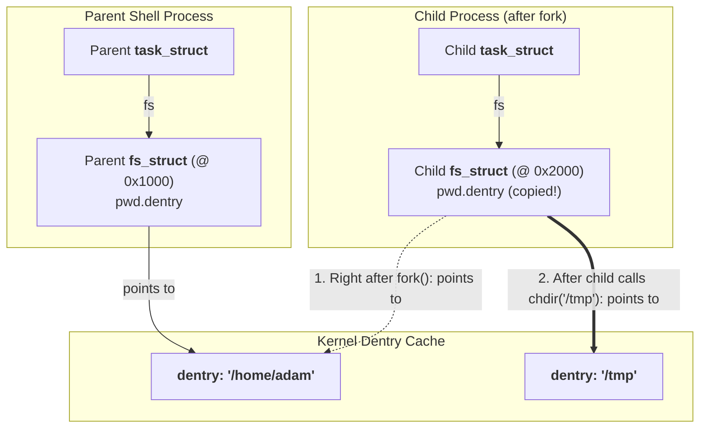

# Kernel Layout: `task_struct` to `pwd`

When the Linux kernel tracks where your process currently is, it uses a three-level structure defined across `<linux/sched.h>`, `<linux/fs_struct.h>`, and `<linux/path.h>`.



## Exact Kernel C Definitions (Simplified)

```c
// 1. include/linux/sched.h
struct task_struct {
    // ... scheduler state, PID, credentials ...
    struct fs_struct *fs;  // Filesystem information pointer
    struct files_struct *files; // Open file descriptors
};

// 2. include/linux/fs_struct.h
struct fs_struct {
    int users;             // Reference count (shared by threads, copied on fork)
    spinlock_t lock;
    seqcount_spinlock_t seq;
    int umask;
    int in_exec;
    struct path root;      // Process root directory (usually /)
    struct path pwd;       // Present Working Directory!
};

// 3. include/linux/path.h
struct path {
    struct vfsmount *mnt;  // Which mounted filesystem (e.g., ext4 on /dev/nvme0n1p2)
    struct dentry *dentry; // Pointer to the live directory node in the VFS tree
};
```

---

## What Happens During `fork()` (`copy_fs` in `kernel/fork.c`)

When a shell calls `fork()`, the kernel allocates a **new** `task_struct` and a **new** `fs_struct` for the child, copying the `pwd.dentry` pointer value from the parent:



- **Why `/bin/pwd` works in a child**: Right after `fork()`, the child's `fs_struct->pwd` points to the exact same `dentry` (`/home/adam`) as the parent. Reading and printing it gives the parent's current directory.
- **Why `/bin/cd` cannot work in a child**: Calling `chdir("/tmp")` inside the child only repoints the **child's** `fs_struct->pwd` (`@ 0x2000`) to `/tmp`. Then the child exits and `@ 0x2000` is freed—leaving the parent shell's `fs_struct->pwd` (`@ 0x1000`) untouched at `/home/adam`!

